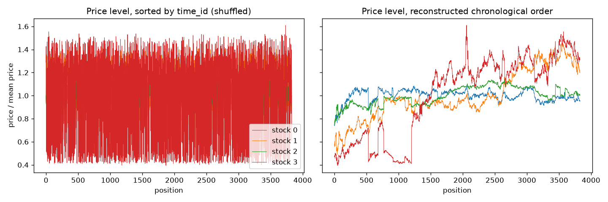
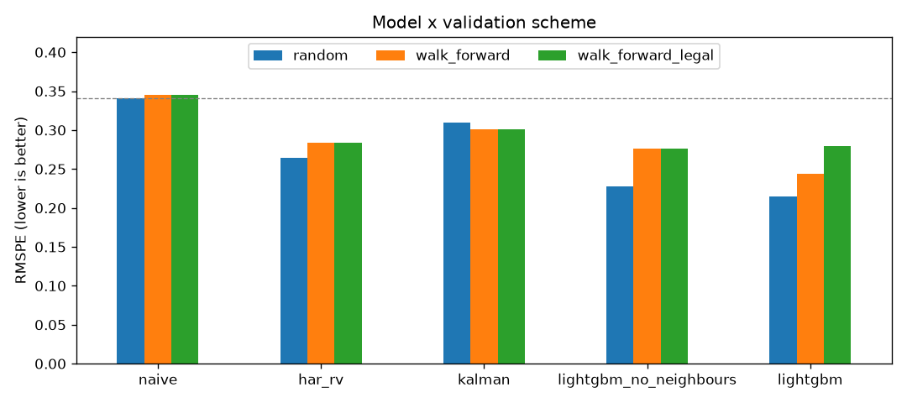

# Realized volatility from order-book data: how much of the edge is look-ahead?

**Question.** Forecast the next 10-minute realized volatility of 112 stocks from limit-order-book snapshots
(Optiver Realized Volatility Prediction dataset), and measure how much of the top competition scores came
from information that would not be available in production (reconstructed `time_id` ordering, cross-time
neighbour features).

## Data
Kaggle competition `optiver-realized-volatility-prediction`. Accept the competition rules on Kaggle, then:
```
kaggle competitions download -c optiver-realized-volatility-prediction -p data/
unzip data/optiver-realized-volatility-prediction.zip -d data/
```
`data/` is git-ignored.

## Run
```
python -m pip install -e ".[dev]"
pytest
python scripts/run_cv.py        # ~3 min on 12 cores; writes reports/results.csv
```
Or step through `notebooks/02_full_pipeline.ipynb`, which calls the same code and plots each stage.

## Definitions
- WAP = (bid_price1 * ask_size1 + ask_price1 * bid_size1) / (bid_size1 + ask_size1)
- log return r_t = log(WAP_t / WAP_{t-1}) over consecutive book updates
- realized volatility RV = sqrt(sum r_t^2)
- metric RMSPE = sqrt(mean(((y - yhat) / y)^2))

## Validation design
1. Random K-fold over `time_id` (what most public notebooks report).
2. Walk-forward over reconstructed `time_id` order (train on past, test on future).
3. Walk-forward with "production-legal" features only (no neighbour features built from future time_ids).

Gap 1 -> 2 = optimism from random CV. Gap 2 -> 3 = share of edge that is not tradeable.

**Recovering time order.** Prices are normalised to ~1 in each window, but the tick is $0.01, so the smallest gap
between distinct normalised prices gives the real price: `0.01 / min_gap`. Windows close in time have similar
real prices across all 112 stocks; a 1-D t-SNE of the standardised log-price cross-section orders them along the
time axis. Direction is set so that each window's target (RV of the *next* 10 min) is closer to the following
window's RV than to the preceding one's.



**Neighbour features.** Each stock's mean RV over the 10 windows with the closest price cross-section. Unrestricted,
those neighbours include the windows right after the current one, whose RV is nearly the target. The legal version
only uses earlier windows in the reconstructed order.

## Models
| Model | Description |
|---|---|
| Naive | RV of the observed 10-minute window |
| HAR-RV | Linear regression on RV over sub-windows (last 1, 5, 10 min) |
| Kalman | Local-level state-space model on log RV |
| LightGBM | Book + trade features, predicts target / RV with weight (RV / target)^2 (RMSPE-consistent) |
| LightGBM + neighbours | Same, plus neighbour features |

## Results
RMSPE, pooled over the test rows of 5 folds (lower is better). Walk-forward folds test on the last 5/6 of the
reconstructed timeline. Models without neighbour features are identical in the last two columns.

| Model | Random CV | Walk-forward | Walk-forward, legal features |
|---|---|---|---|
| Naive | 0.341 | 0.345 | 0.345 |
| HAR-RV | 0.264 | 0.284 | 0.284 |
| Kalman | 0.310 | 0.301 | 0.301 |
| LightGBM | 0.228 | 0.276 | 0.276 |
| LightGBM + neighbours | **0.214** | 0.244 | 0.279 |



**Findings**
- Random CV flatters every learned model: LightGBM goes from 0.214 to 0.244 once it is tested on the future.
- Neighbour features are worth 0.032 RMSPE under walk-forward (0.276 -> 0.244), but only because they see the
  future. Restricted to the past they add nothing (0.279 vs 0.276).
- The best production-legal model is LightGBM without neighbours at 0.276: 20% better than naive, 3% better
  than a three-coefficient HAR regression. The headline 0.214 looks 0.070 better than HAR under walk-forward
  (0.284); only 0.008 of that survives with legal features and honest validation.

## What did not work
- **LightGBM on the RV level.** Trained on the target itself with weight 1/y^2, LightGBM scored 0.310 under
  walk-forward, worse than HAR: trees cannot extrapolate to volatility regimes absent from the training years.
  Predicting the ratio target / RV fixed it (0.276).
- **Kalman filter.** Filtering log RV across windows (0.301) loses to HAR (0.284), which reads the most recent
  minutes inside the current window. The filter only sees each window's total RV, and the reconstructed sequence
  is noisy, so its smoothed level lags the current regime.
- **Order reconstruction is imperfect.** The recovered timeline is smooth for most stocks, but some blocks are
  misplaced (stock 3, positions ~500-1200 in `reports/time_order.png`), and the direction check is a small
  margin (0.323 vs 0.345). Walk-forward folds are therefore only approximately chronological.

## Layout
```
src/rv/        features, metrics, baselines (models), cv, data (loading + cache), experiment (model x scheme grid)
scripts/       run_cv.py entry point
notebooks/     01: RV vs target on stock 0; 02: full pipeline with plots. No logic.
reports/       figures, results.csv, submission.csv
tests/         unit tests on metrics, features and cv
```

## References
- Optiver competition 1st place write-up (nyanp), Kaggle discussion 274970
- michaelpoluektov/orvp: competition model vs production-legal model
- Corsi (2009), A simple approximate long-memory model of realized volatility (HAR-RV)
